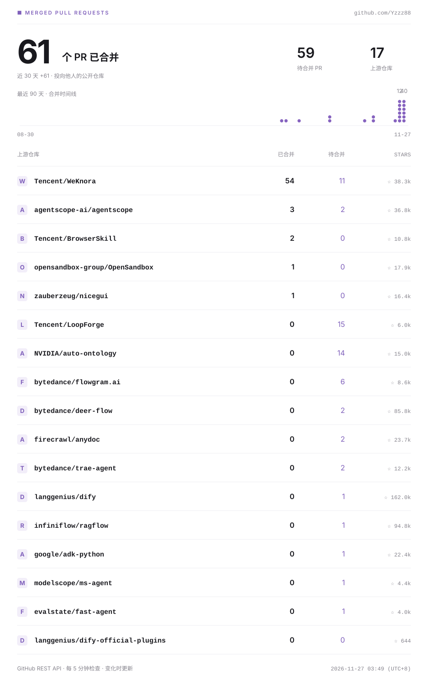

<!-- Generated by scripts/generate_stats.py. Public GitHub data only. -->
<picture>
  <source media="(max-width: 600px)" srcset="assets/hero-mobile.svg">
  
</picture>

<a href="https://github.com/search?q=is%3Apr+is%3Amerged+author%3AYzzz88&amp;type=pullrequests">
<picture>
  <source media="(max-width: 600px)" srcset="assets/contributions-mobile.svg">
  
</picture>
</a>

### 开源贡献

待合并 PR 尚未被上游合并；状态与链接随公开数据更新。

#### 已合并 · [WeKnora #4893](https://github.com/Tencent/WeKnora/pull/4893)

fix(docreader): preserve fenced base64 image examples

仓库：[Tencent/WeKnora](https://github.com/Tencent/WeKnora)

#### 已合并 · [WeKnora #5156](https://github.com/Tencent/WeKnora/pull/5156)

fix(docparser): preserve DOCX vector assets through fallback

仓库：[Tencent/WeKnora](https://github.com/Tencent/WeKnora)

#### 已合并 · [WeKnora #5260](https://github.com/Tencent/WeKnora/pull/5260)

fix(agent): budget rendered document query rows

仓库：[Tencent/WeKnora](https://github.com/Tencent/WeKnora)

#### 已合并 · [agentscope #4000](https://github.com/agentscope-ai/agentscope/pull/4000)

fix(rag): preserve run tabs in Word table cells

仓库：[agentscope-ai/agentscope](https://github.com/agentscope-ai/agentscope)

#### 已合并 · [agentscope #4130](https://github.com/agentscope-ai/agentscope/pull/4130)

fix(rag): index PPTX text with text-only embedding models

仓库：[agentscope-ai/agentscope](https://github.com/agentscope-ai/agentscope)

#### 已合并 · [agentscope #4131](https://github.com/agentscope-ai/agentscope/pull/4131)

fix(rag): report PDFs with no indexable text

仓库：[agentscope-ai/agentscope](https://github.com/agentscope-ai/agentscope)

#### 已合并 · [OpenSandbox #2474](https://github.com/opensandbox-group/OpenSandbox/pull/2474)

修复服务端主机路径白名单对 POSIX 根路径的判断

仓库：[opensandbox-group/OpenSandbox](https://github.com/opensandbox-group/OpenSandbox)

#### 已合并 · [nicegui #6449](https://github.com/zauberzeug/nicegui/pull/6449)

Fix deep-copied observables notifying their original parent

仓库：[zauberzeug/nicegui](https://github.com/zauberzeug/nicegui)

#### 已关闭，未合并 · [BrowserSkill #591](https://github.com/Tencent/BrowserSkill/pull/591)

fix: reject inherited names as press keys

仓库：[Tencent/BrowserSkill](https://github.com/Tencent/BrowserSkill)

#### 待合并 · [WeKnora #5135](https://github.com/Tencent/WeKnora/pull/5135)

fix: preview resources with unsaved datasource credentials

仓库：[Tencent/WeKnora](https://github.com/Tencent/WeKnora)

#### 待合并 · [WeKnora #5476](https://github.com/Tencent/WeKnora/pull/5476)

fix(docreader): extract designated EPUB cover images

仓库：[Tencent/WeKnora](https://github.com/Tencent/WeKnora)

#### 待合并 · [WeKnora #5753](https://github.com/Tencent/WeKnora/pull/5753)

fix(catalog): read and generate model JSON as UTF-8

仓库：[Tencent/WeKnora](https://github.com/Tencent/WeKnora)

#### 待合并 · [WeKnora #5754](https://github.com/Tencent/WeKnora/pull/5754)

fix(mcp): let an explicit port override the environment

仓库：[Tencent/WeKnora](https://github.com/Tencent/WeKnora)

#### 待合并 · [WeKnora #5755](https://github.com/Tencent/WeKnora/pull/5755)

fix(build): resolve version metadata from the script checkout

仓库：[Tencent/WeKnora](https://github.com/Tencent/WeKnora)

#### 待合并 · [WeKnora #5756](https://github.com/Tencent/WeKnora/pull/5756)

fix(mcp): check for the required server API during preflight

仓库：[Tencent/WeKnora](https://github.com/Tencent/WeKnora)

#### 待合并 · [WeKnora #5757](https://github.com/Tencent/WeKnora/pull/5757)

fix(demo): use a configured reranker model and report load failures

仓库：[Tencent/WeKnora](https://github.com/Tencent/WeKnora)

#### 待合并 · [WeKnora #5758](https://github.com/Tencent/WeKnora/pull/5758)

fix(mcp): request recursive knowledge folder listings

仓库：[Tencent/WeKnora](https://github.com/Tencent/WeKnora)

#### 待合并 · [WeKnora #5759](https://github.com/Tencent/WeKnora/pull/5759)

fix(mcp): return the persisted answer on chat completion

仓库：[Tencent/WeKnora](https://github.com/Tencent/WeKnora)

#### 待合并 · [WeKnora #5760](https://github.com/Tencent/WeKnora/pull/5760)

fix(client): report failures in knowledge move progress

仓库：[Tencent/WeKnora](https://github.com/Tencent/WeKnora)

#### 待合并 · [WeKnora #5761](https://github.com/Tencent/WeKnora/pull/5761)

fix(client): preserve chunking strategy on knowledge base updates

仓库：[Tencent/WeKnora](https://github.com/Tencent/WeKnora)

#### 待合并 · [WeKnora #5762](https://github.com/Tencent/WeKnora/pull/5762)

fix(client): retain the target of MCP and skill mentions

仓库：[Tencent/WeKnora](https://github.com/Tencent/WeKnora)

#### 待合并 · [WeKnora #5763](https://github.com/Tencent/WeKnora/pull/5763)

fix(client): expose original document locations with search hits

仓库：[Tencent/WeKnora](https://github.com/Tencent/WeKnora)

#### 待合并 · [WeKnora #5764](https://github.com/Tencent/WeKnora/pull/5764)

fix(client): retain token usage on completed turns and message reload

仓库：[Tencent/WeKnora](https://github.com/Tencent/WeKnora)

#### 待合并 · [WeKnora #5765](https://github.com/Tencent/WeKnora/pull/5765)

feat(client): send the active page and selected text with assistant questions

仓库：[Tencent/WeKnora](https://github.com/Tencent/WeKnora)

#### 待合并 · [WeKnora #5766](https://github.com/Tencent/WeKnora/pull/5766)

feat(client): pass parser overrides for individual knowledge imports

仓库：[Tencent/WeKnora](https://github.com/Tencent/WeKnora)

#### 待合并 · [WeKnora #5767](https://github.com/Tencent/WeKnora/pull/5767)

feat(client): configure OAuth for an MCP service after discovery

仓库：[Tencent/WeKnora](https://github.com/Tencent/WeKnora)

#### 待合并 · [WeKnora #5768](https://github.com/Tencent/WeKnora/pull/5768)

fix(client): send knowledge tags in the server wire format

仓库：[Tencent/WeKnora](https://github.com/Tencent/WeKnora)

#### 待合并 · [WeKnora #5769](https://github.com/Tencent/WeKnora/pull/5769)

feat(mcp): follow wiki index cursors by page type

仓库：[Tencent/WeKnora](https://github.com/Tencent/WeKnora)

#### 待合并 · [WeKnora #5770](https://github.com/Tencent/WeKnora/pull/5770)

fix(mcp): allow chat without retrieval for mention-only agents

仓库：[Tencent/WeKnora](https://github.com/Tencent/WeKnora)

#### 待合并 · [WeKnora #5775](https://github.com/Tencent/WeKnora/pull/5775)

fix(cli): report remaining documents after single-page requests

仓库：[Tencent/WeKnora](https://github.com/Tencent/WeKnora)

#### 待合并 · [WeKnora #5776](https://github.com/Tencent/WeKnora/pull/5776)

fix(cli): guide empty filename searches toward content search

仓库：[Tencent/WeKnora](https://github.com/Tencent/WeKnora)

#### 待合并 · [WeKnora #5777](https://github.com/Tencent/WeKnora/pull/5777)

fix(cli): allow listing manual documents in draft status

仓库：[Tencent/WeKnora](https://github.com/Tencent/WeKnora)

#### 待合并 · [WeKnora #5778](https://github.com/Tencent/WeKnora/pull/5778)

fix(cli): title new chat sessions from the opening question

仓库：[Tencent/WeKnora](https://github.com/Tencent/WeKnora)

#### 待合并 · [WeKnora #5779](https://github.com/Tencent/WeKnora/pull/5779)

fix(client): preserve subsecond document filter boundaries

仓库：[Tencent/WeKnora](https://github.com/Tencent/WeKnora)

#### 待合并 · [WeKnora #5780](https://github.com/Tencent/WeKnora/pull/5780)

feat(cli): distinguish and filter document folders in listings

仓库：[Tencent/WeKnora](https://github.com/Tencent/WeKnora)

#### 待合并 · [WeKnora #5781](https://github.com/Tencent/WeKnora/pull/5781)

feat(cli): publish inline documents at creation time

仓库：[Tencent/WeKnora](https://github.com/Tencent/WeKnora)

#### 待合并 · [WeKnora #5782](https://github.com/Tencent/WeKnora/pull/5782)

fix(cli): classify per-file errors in recursive uploads

仓库：[Tencent/WeKnora](https://github.com/Tencent/WeKnora)

#### 待合并 · [WeKnora #5783](https://github.com/Tencent/WeKnora/pull/5783)

feat(cli): scope chunk retrieval to selected documents

仓库：[Tencent/WeKnora](https://github.com/Tencent/WeKnora)

#### 待合并 · [WeKnora #5784](https://github.com/Tencent/WeKnora/pull/5784)

fix(cli): distinguish unavailable document chunk counts from zero

仓库：[Tencent/WeKnora](https://github.com/Tencent/WeKnora)

#### 待合并 · [agentscope #3593](https://github.com/agentscope-ai/agentscope/pull/3593)

尝试次数耗尽时先收束状态，再发出步骤结束事件

仓库：[agentscope-ai/agentscope](https://github.com/agentscope-ai/agentscope)

#### 待合并 · [agentscope #4002](https://github.com/agentscope-ai/agentscope/pull/4002)

fix(rag): preserve PDF page numbers in citations

仓库：[agentscope-ai/agentscope](https://github.com/agentscope-ai/agentscope)

#### 待合并 · [deer-flow #7715](https://github.com/bytedance/deer-flow/pull/7715)

防止数据分析导出文件覆盖输入文件

仓库：[bytedance/deer-flow](https://github.com/bytedance/deer-flow)

#### 已关闭，未合并 · [deer-flow #7719](https://github.com/bytedance/deer-flow/pull/7719)

fix(skills): keep data-analysis cache snapshots read-only

仓库：[bytedance/deer-flow](https://github.com/bytedance/deer-flow)

#### 待合并 · [deer-flow #7980](https://github.com/bytedance/deer-flow/pull/7980)

fix(artifacts): reject ZIP file-directory path collisions

仓库：[bytedance/deer-flow](https://github.com/bytedance/deer-flow)

#### 待合并 · [flowgram.ai #1252](https://github.com/bytedance/flowgram.ai/pull/1252)

fix(runtime): report loop iteration failures

仓库：[bytedance/flowgram.ai](https://github.com/bytedance/flowgram.ai)

#### 待合并 · [flowgram.ai #1254](https://github.com/bytedance/flowgram.ai/pull/1254)

fix(runtime): stop evaluating conditions after a match

仓库：[bytedance/flowgram.ai](https://github.com/bytedance/flowgram.ai)

#### 待合并 · [flowgram.ai #1256](https://github.com/bytedance/flowgram.ai/pull/1256)

fix(runtime): preserve explicit null workflow outputs

仓库：[bytedance/flowgram.ai](https://github.com/bytedance/flowgram.ai)

#### 待合并 · [flowgram.ai #1280](https://github.com/bytedance/flowgram.ai/pull/1280)

fix(runtime): stop HTTP retries after workflow cancellation

仓库：[bytedance/flowgram.ai](https://github.com/bytedance/flowgram.ai)

#### 待合并 · [flowgram.ai #1281](https://github.com/bytedance/flowgram.ai/pull/1281)

fix(runtime): report missing outputs from loop iterations

仓库：[bytedance/flowgram.ai](https://github.com/bytedance/flowgram.ai)

#### 待合并 · [flowgram.ai #1282](https://github.com/bytedance/flowgram.ai/pull/1282)

fix(runtime): let Fetch set the multipart boundary

仓库：[bytedance/flowgram.ai](https://github.com/bytedance/flowgram.ai)

#### 待合并 · [trae-agent #562](https://github.com/bytedance/trae-agent/pull/562)

fix(ckg): invalidate persisted snapshots when dirty file contents change

仓库：[bytedance/trae-agent](https://github.com/bytedance/trae-agent)

#### 待合并 · [trae-agent #563](https://github.com/bytedance/trae-agent/pull/563)

fix(bash): serialize shared shell session operations

仓库：[bytedance/trae-agent](https://github.com/bytedance/trae-agent)

#### 待合并 · [fast-agent #1062](https://github.com/evalstate/fast-agent/pull/1062)

test: cover stream retry recovery

仓库：[evalstate/fast-agent](https://github.com/evalstate/fast-agent)

#### 待合并 · [anydoc #221](https://github.com/firecrawl/anydoc/pull/221)

fix(pptx): preserve sparse chart point alignment

仓库：[firecrawl/anydoc](https://github.com/firecrawl/anydoc)

#### 待合并 · [anydoc #222](https://github.com/firecrawl/anydoc/pull/222)

fix(docx): retain embedded OLE preview images

仓库：[firecrawl/anydoc](https://github.com/firecrawl/anydoc)

#### 待合并 · [adk-python #7986](https://github.com/google/adk-python/pull/7986)

fix(live): detect audio media types case insensitively

仓库：[google/adk-python](https://github.com/google/adk-python)

#### 待合并 · [ragflow #22127](https://github.com/infiniflow/ragflow/pull/22127)

fix(upload): preserve Markdown source during normalization

仓库：[infiniflow/ragflow](https://github.com/infiniflow/ragflow)

#### 已关闭，未合并 · [dify-official-plugins #4150](https://github.com/langgenius/dify-official-plugins/pull/4150)

按匹配索引删除 JSON 数组元素

仓库：[langgenius/dify-official-plugins](https://github.com/langgenius/dify-official-plugins)

#### 待合并 · [dify #45122](https://github.com/langgenius/dify/pull/45122)

fix(nodejs-client): default omitted chat and completion inputs to empty objects

仓库：[langgenius/dify](https://github.com/langgenius/dify)

#### 待合并 · [ms-agent #1036](https://github.com/modelscope/ms-agent/pull/1036)

异步淘汰会话后重新检查准入条件

仓库：[modelscope/ms-agent](https://github.com/modelscope/ms-agent)

#### 已关闭，未合并 · [OpenSandbox #2483](https://github.com/opensandbox-group/OpenSandbox/pull/2483)

修复 Python SDK 空闲池重插入后的 FIFO 顺序

仓库：[opensandbox-group/OpenSandbox](https://github.com/opensandbox-group/OpenSandbox)

统计范围：本人提交至他人公开仓库的 Pull Request；已合并与待合并分别计数。Star 数随上游变化。
