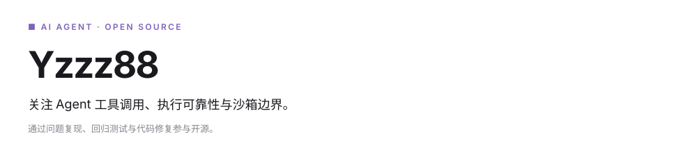
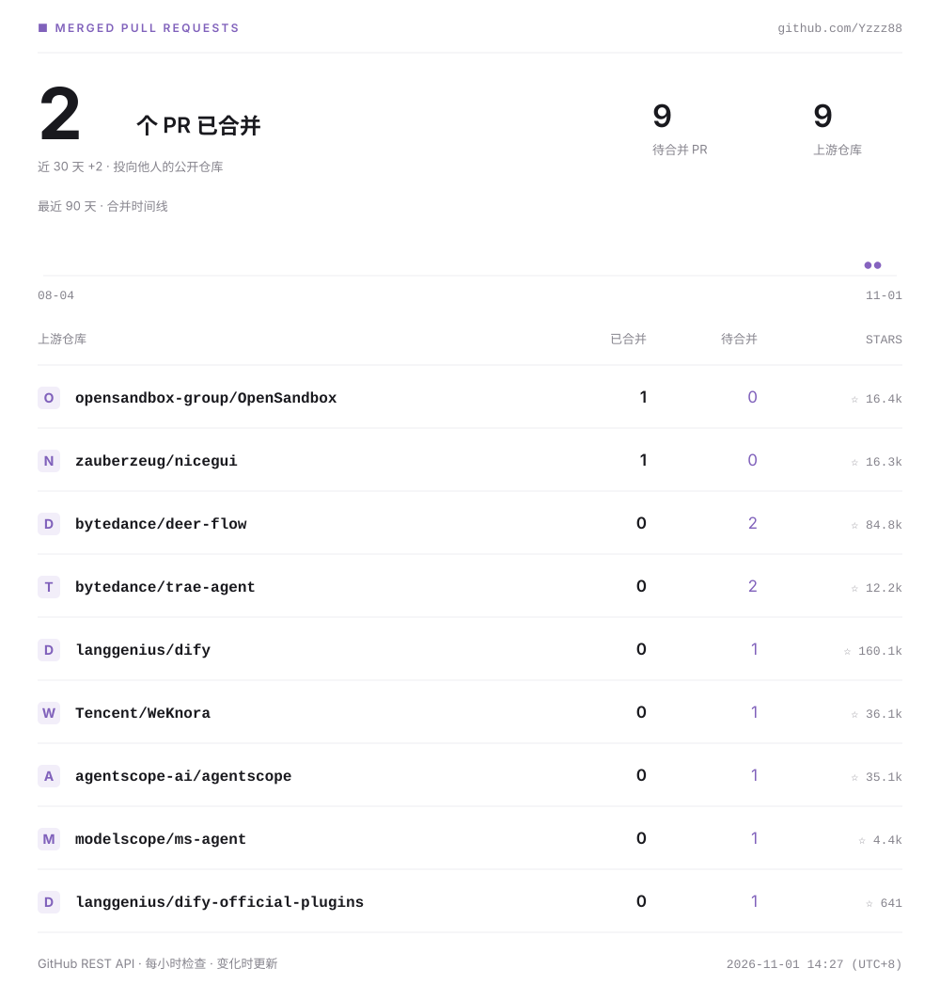

<!-- Generated by scripts/generate_stats.py. Public GitHub data only. -->

### 开源贡献

以下状态由公开 PR 数据自动更新；待合并表示尚未被上游合并。

| 仓库 | 贡献内容 | 状态 |
| --- | --- | --- |
| [opensandbox-group/OpenSandbox](https://github.com/opensandbox-group/OpenSandbox) | [修复服务端主机路径白名单对 POSIX 根路径的判断 · #2474](https://github.com/opensandbox-group/OpenSandbox/pull/2474) | 已合并 |
| [agentscope-ai/agentscope](https://github.com/agentscope-ai/agentscope) | [尝试次数耗尽时先收束状态，再发出步骤结束事件 · #3593](https://github.com/agentscope-ai/agentscope/pull/3593) | 待合并 |
| [bytedance/deer-flow](https://github.com/bytedance/deer-flow) | [防止数据分析导出文件覆盖输入文件 · #7715](https://github.com/bytedance/deer-flow/pull/7715) | 待合并 |
| [langgenius/dify-official-plugins](https://github.com/langgenius/dify-official-plugins) | [按匹配索引删除 JSON 数组元素 · #4150](https://github.com/langgenius/dify-official-plugins/pull/4150) | 待合并 |
| [modelscope/ms-agent](https://github.com/modelscope/ms-agent) | [异步淘汰会话后重新检查准入条件 · #1036](https://github.com/modelscope/ms-agent/pull/1036) | 待合并 |
| [opensandbox-group/OpenSandbox](https://github.com/opensandbox-group/OpenSandbox) | [修复 Python SDK 空闲池重插入后的 FIFO 顺序 · #2483](https://github.com/opensandbox-group/OpenSandbox/pull/2483) | 待合并 |

统计范围：本人提交至他人公开仓库的 Pull Request；已合并与待合并分别计数。Star 数随上游变化。
